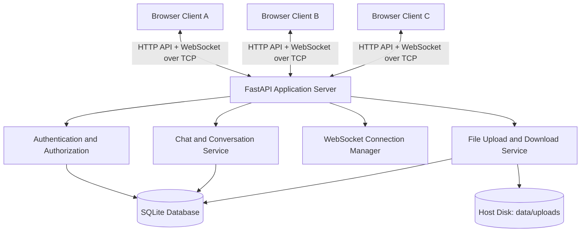

# LAN Chat Application: Architecture and Development Plan

## 1. Project objective

Build a responsive, browser-based chat application for users on the same reachable Local Area Network (LAN). The app must continue to work when the LAN has no internet connection. One computer hosts the application server; the other devices open the host's LAN IP address in a browser.

The supplied PPT establishes these baseline ideas:

- Client-server architecture with one central server handling multiple clients.
- Username-based user identification.
- Private one-to-one messages and group conversations.
- Real-time communication over TCP/IP.
- Optional file exchange over the local network.
- Concurrent clients and a simple interface.

The PPT lists Python sockets and Tkinter for a desktop implementation. This plan replaces the desktop GUI with a web frontend but preserves the project goal and the networking concepts. WebSockets will provide real-time browser communication over TCP; HTTP APIs will handle actions such as account access, history, group management, and files.

## 2. Key architecture decision

**Run one local server; let every client connect to it.**

Example:

- Host laptop LAN IP: `192.168.1.20`
- Application port: `8000`
- Other devices visit: `http://192.168.1.20:8000`
- Browser live connection: `ws://192.168.1.20:8000/ws`

The IP above is an example only; use the real address assigned to the host laptop.

The application server routes messages, checks permissions, persists chat history, and manages file access. Uploaded files are stored on the host laptop, rather than in a cloud drive or an external service. This centralized file-transfer design is simpler and more reliable for the first version than peer-to-peer transfers between browsers.

### LAN-only requirements

- Devices must be able to reach one another on the same LAN/subnet. Being connected to the same Wi-Fi name is not sufficient if the access point uses client isolation or a guest network.
- The server must listen on `0.0.0.0`, not only `127.0.0.1`.
- The host firewall must allow inbound TCP on the chosen port for the private network.
- Build the frontend and install Python/Node dependencies before the offline demonstration. The running application must not fetch JavaScript, fonts, images, authentication, or data from internet-hosted services.
- No internet connection is required at runtime, but the host computer and local network must be running. This is not a device-to-device app that works with no network at all.
- Do not configure public port forwarding. The intended deployment is LAN-only.

## 3. Recommended technology stack

| Layer | Recommendation | Purpose |
|---|---|---|
| Frontend | React + TypeScript + Vite | Responsive browser UI and maintainable component structure |
| Styling | CSS modules or a locally installed utility CSS framework | Consistent layout without external assets/CDNs |
| Backend | Python + FastAPI | REST APIs, WebSocket endpoint, validation and access control |
| ASGI server | Uvicorn | Run HTTP and WebSocket traffic |
| Real-time channel | WebSockets | Persistent, bidirectional communication over TCP |
| Database | SQLite | Local persistence without a separate database server |
| ORM | SQLAlchemy 2.x | Database models and queries |
| SQLite async driver | aiosqlite | Async database operations in the async backend |
| Password hashing | Argon2 via a maintained password-hashing library | Avoid storing plaintext passwords |
| File storage | Local `data/uploads/` directory | Store uploaded files outside the public static web directory |
| Backend tests | pytest + HTTPX/WebSocket test support | Verify API, permissions and real-time behaviour |
| Frontend tests | Vitest + React Testing Library (optional but recommended) | Verify important UI behaviour |

Avoid introducing Redis, Kubernetes, microservices, cloud storage, or multiple backend workers for the first version. A single FastAPI process and SQLite database are sufficient for a college LAN demonstration. If the in-memory WebSocket connection manager is used, run one server worker; multiple workers would have separate connection maps and would not broadcast to each other's clients without shared pub/sub infrastructure.

## 4. System architecture



### Main components

1. **Browser UI**: login/register page, user list, conversation list, messages, group details, upload progress and notifications.
2. **FastAPI HTTP API**: handles login, user lookup, conversation creation, history retrieval, group membership, file upload/download, and message editing/deletion if included.
3. **WebSocket endpoint**: accepts authenticated sessions, receives live chat events, and pushes messages/presence changes to connected users.
4. **Connection manager**: maps each online user ID to one or more active WebSocket connections. It supports multiple tabs/devices for a user and removes stale connections on disconnect.
5. **Domain/service layer**: validates actions, checks membership/roles, saves changes, then emits events. API routes and WebSocket handlers should call the same service functions rather than duplicate permission logic.
6. **Database layer**: stores users, conversations, conversation membership, message records, and attachment metadata.
7. **File storage layer**: stores binary file content on the host disk; database rows store metadata and a generated storage key, not public filesystem paths.

### Important message-delivery rule

For every text message, the server must:

1. Authenticate the WebSocket session and derive the sender from the session. Never trust a `sender_id` sent by the browser.
2. Validate the payload and verify the sender is an active member of the conversation.
3. Persist the message to SQLite before announcing successful delivery.
4. Broadcast the saved message to the online participants authorized to see it.
5. Return a server-generated message ID and timestamp.

Messages must be persisted even when recipients are offline. When an offline user reconnects, the client fetches conversation history through the HTTP API. This avoids pretending that an offline browser received a live event.

## 5. Functional requirements and priorities

### Phase 1 — required working product

- **FR-01: Account access** — Register and log in with a unique username and password. Passwords are hashed. Provide logout and a `current user` endpoint.
- **FR-02: Online users** — Show users who currently have an active WebSocket connection. Presence must update on connect/disconnect and tolerate abrupt disconnects.
- **FR-03: Direct messages** — Start/reopen a one-to-one conversation, send live text messages, and load past messages.
- **FR-04: Group conversations** — Create a group with a name and initial members; send messages to all active group members.
- **FR-05: Membership management** — Group owner/admin may add or remove members. A regular member may leave. Enforce these rules on the server, not just by hiding UI buttons.
- **FR-06: File sharing** — Upload a file into a direct or group conversation and show the filename, size, upload time, and a download action. Only authorized conversation members may upload/download.
- **FR-07: Message history** — Messages survive application/client restarts because they are persisted in the database. Load history in pages rather than loading every message at once.
- **FR-08: Reconnection** — Reconnect WebSockets after network interruption, then refresh presence and conversation history without duplicating messages.
- **FR-09: LAN deployment** — Serve the built frontend and API from the same host/port for the demo; no external API, cloud database, CDN, or internet dependency at runtime.

### Phase 2 — valuable enhancements after Phase 1 passes

- Unread-message counts and last-read markers/read receipts.
- Typing indicators.
- Replies to a message.
- Edit/delete own messages, with a visible edited/deleted marker.
- Message search within conversations.
- Image/document previews for safe supported types.
- Emoji reactions.
- Desktop/browser notifications where supported.
- Dark mode and further responsive/mobile polish.
- Group system events such as “A added B” or “C left the group.”

Do not start Phase 2 until login, direct messages, groups, files, history, permissions, and a two-device LAN test are reliable.

## 6. User interface plan

### Main layout

- **Left sidebar**: application name, current profile, online users, direct conversations, group conversations, “New chat,” and “Create group.”
- **Conversation header**: name/avatar or initials, online status (for a direct chat), group member count, and a group-details action.
- **Message pane**: sender, timestamp, message body, file cards, system events, and date separators. Visually distinguish the current user's messages from others.
- **Composer**: text input, send button, attach-file button, Enter-to-send with Shift+Enter for a newline, and upload progress.
- **Group details panel/modal**: group name, members, roles, add/remove controls, and leave-group action.
- **Login/register view**: simple form with visible validation and useful error messages.
- **Connection state**: show “Connecting,” “Connected,” or “Reconnecting” so users understand why messages may not be sending.

Use a clean, responsive layout. The desktop view can use three regions (sidebar, conversation, details panel); on narrow screens the sidebar/details panel should become drawers or separate screens. Avoid remote icon/font CDNs because they create hidden internet dependencies.

## 7. Data model

Use integer or UUID primary keys consistently. Use UTC timestamps in the database and convert to local time in the UI.

### `users`

- `id`
- `username` — unique, normalized for case handling
- `display_name`
- `password_hash`
- `role` — such as `user` or `admin` if an app-level admin is implemented
- `is_active`
- `created_at`
- `last_seen_at`

### `conversations`

- `id`
- `type` — `direct` or `group`
- `name` — required for groups, optional for direct chats
- `created_by`
- `direct_key` — normalized unique key for a pair of users; populated only for direct conversations to prevent duplicate direct-chat records
- `created_at`
- `updated_at`

### `conversation_members`

- `id`
- `conversation_id`
- `user_id`
- `role` — `owner`, `admin`, or `member` for groups; direct-chat participants use a standard participant role
- `is_active`
- `joined_at`
- `last_read_message_id` — supports unread counts/read receipts in a later phase
- Unique constraint on `(conversation_id, user_id)` for the simple first version

When a user is removed from a group, mark membership inactive instead of deleting the row. The policy for the first version should be that inactive members cannot fetch new group history, send messages, download group files, or receive live group events. Re-adding a user can reactivate the membership row; document if re-added members regain access to earlier history.

### `messages`

- `id`
- `conversation_id`
- `sender_id` — nullable only for system events if needed
- `client_message_id` — optional client-generated ID for retry/deduplication
- `message_type` — `text`, `file`, or `system`
- `content` — text for normal messages, system text for system events; do not store binary files here
- `reply_to_message_id` — nullable, for the reply enhancement
- `created_at`
- `edited_at` — nullable
- `deleted_at` — nullable

Add indexes on `(conversation_id, created_at)` and on message sender/client ID if idempotent retries are implemented.

### `attachments`

- `id`
- `message_id`
- `original_filename` — sanitized display name
- `storage_key` — generated opaque filename, not a user-supplied path
- `mime_type` — treated as untrusted metadata
- `size_bytes`
- `sha256` — useful for integrity testing
- `uploaded_by`
- `created_at`

### `sessions` (recommended)

Store server-managed sessions using a random opaque token; place only the token in an `HttpOnly`, `SameSite=Lax` cookie and store a hash of the token server-side. Set `Secure` when deploying over HTTPS. Expire sessions and invalidate them on logout. This keeps passwords and long-lived authentication secrets out of browser JavaScript.

## 8. HTTP API outline

Use a common JSON error shape, appropriate HTTP status codes, request validation, and pagination. Prefix application routes with `/api`.

### Authentication and account

- `POST /api/auth/register` — create account
- `POST /api/auth/login` — authenticate and establish session
- `POST /api/auth/logout` — invalidate session
- `GET /api/me` — return the current user
- `GET /api/users?search=...` — search eligible users for a new chat or group

### Conversations and messages

- `GET /api/conversations` — conversations visible to the current user
- `POST /api/conversations/direct` — get or create a direct conversation with a target user
- `POST /api/conversations/groups` — create a group with a name and initial member IDs
- `PATCH /api/conversations/{conversation_id}` — rename a group (owner/admin only)
- `GET /api/conversations/{conversation_id}/messages?before=...&limit=50` — fetch paginated history
- `POST /api/conversations/{conversation_id}/members` — add a user (owner/admin only)
- `DELETE /api/conversations/{conversation_id}/members/{user_id}` — remove a member (owner/admin only, with owner protections)
- `POST /api/conversations/{conversation_id}/leave` — leave a group, subject to owner/transfer rules
- `PATCH /api/messages/{message_id}` — edit an own message (optional enhancement)
- `DELETE /api/messages/{message_id}` — delete/soft-delete an own message (optional enhancement)
- `GET /api/health` — return a simple health status for diagnostics

### Attachments

- `POST /api/conversations/{conversation_id}/attachments` — multipart upload; validate membership and size, store the binary file, create attachment/message records, then broadcast `message.created`
- `GET /api/attachments/{attachment_id}/download` — authorize access through the related conversation before streaming the file

Do not expose `data/uploads/` as a public static directory. Never trust a client-supplied filesystem path, and never return unrestricted local storage paths in responses.

## 9. WebSocket event contract

Endpoint: `WS /ws`. Authenticate the connection from the session cookie during the handshake. Use a consistent JSON envelope, for example:

```json
{
  "type": "message.send",
  "request_id": "client-generated-unique-id",
  "payload": {
    "conversation_id": "conversation-id",
    "client_message_id": "message-retry-id",
    "content": "Hello LAN"
  }
}
```

Use IDs consistent with the database design; strings are shown for readability.

### Client to server

- `message.send` — send text to a conversation
- `typing.start` / `typing.stop` — transient typing signal (Phase 2)
- `message.read` — update the user's last-read marker (Phase 2)
- `ping` — optional application-level heartbeat if needed; WebSocket protocol ping/pong should be preferred where supported

### Server to client

- `connection.ready` — authenticated connection accepted
- `presence.snapshot` — initial online-user state
- `presence.changed` — a user came online/offline
- `message.created` — persisted message ready for display
- `message.ack` — confirms a send request using its `request_id`/`client_message_id`
- `typing.updated` — typing state changed (Phase 2)
- `message.read.updated` — a read marker changed (Phase 2)
- `message.updated` / `message.deleted` — message edited/deleted (Phase 2)
- `conversation.updated` — group metadata or membership changed
- `error` — structured error with a safe code/message; do not leak stack traces

Example `message.created` payload fields: `message_id`, `conversation_id`, `sender` summary, `message_type`, `content`, `created_at`, and attachment metadata if applicable.

### WebSocket reliability rules

- Persist before broadcasting.
- Validate membership on every message send.
- Apply payload/message length limits and reject invalid JSON or unknown event types safely.
- Handle disconnects and clean up all sockets for the disconnected connection.
- Use client-generated IDs or equivalent idempotency to avoid duplicates if the client retries after a temporary disconnect.
- Do not rely on in-memory presence for message history; presence is transient, messages are persistent.
- With a single-process connection manager, run one Uvicorn worker. For larger scale, introduce shared pub/sub only when there is a real need.

## 10. Permissions and group rules

Implement and test server-side rules, not only front-end visibility:

- A user can read a conversation only if they are an active member.
- A user can send into a conversation only if they are an active member.
- A direct message is visible to its two participants only.
- Only a group owner/admin can add or remove other members or rename the group.
- A regular member can leave the group.
- Do not allow removing the owner without first transferring ownership or applying a clearly defined owner-leave rule.
- A removed member cannot receive future group WebSocket events or download group attachments.
- A user may edit/delete only their own messages, unless an admin override is explicitly designed.
- All attachment downloads must check the caller's current authorization to the containing conversation.
- Return `401` for no valid session and `403` for authenticated users lacking permission (or a deliberate `404` policy where hiding resource existence is preferred).

## 11. File-sharing design and safeguards

Use HTTP multipart uploads for the first version. It is simpler to implement and test in a browser than a custom binary WebSocket protocol.

Upload flow:

1. User selects a file in a conversation.
2. Frontend displays filename and upload progress.
3. Server verifies the session and active conversation membership.
4. Server checks file size against a configurable limit (start with 25 MB), generates a random storage key, and streams the content to disk.
5. Server calculates size/hash, stores metadata, creates a `file` message, then broadcasts that message to online conversation members.
6. Recipient clicks Download; server checks current membership and streams the file.

Safeguards:

- Sanitize display filenames and generate storage names independently of user input.
- Prevent path traversal; never concatenate the original filename into a filesystem path.
- Apply request/file size limits and handle interrupted uploads without leaving misleading message records.
- Treat file extensions and MIME types as untrusted. Do not execute uploaded content or render arbitrary HTML/SVG inline.
- Keep uploads outside the frontend build/static directory.
- Do not allow unauthenticated or non-member downloads.
- Consider allowed extensions if the project scope is narrow; otherwise rely on strict size limits and safe download headers.

## 12. Suggested repository structure

```text
lan-chat/
  README.md
  .env.example
  .gitignore
  frontend/
    package.json
    vite.config.ts
    src/
      app/
      components/
      features/
        auth/
        conversations/
        chat/
        groups/
        attachments/
      hooks/
      lib/
        api.ts
        websocket.ts
      types/
      styles/
  backend/
    pyproject.toml or requirements.txt
    app/
      main.py
      core/
        config.py
        security.py
      db/
        session.py
        models.py
        repositories.py
      api/
        auth.py
        users.py
        conversations.py
        messages.py
        attachments.py
        websocket.py
      schemas/
      services/
        auth_service.py
        conversation_service.py
        message_service.py
        attachment_service.py
        presence_service.py
      tests/
  data/
    .gitkeep
    uploads/
  scripts/
    run_server.bat
    run_server.sh
```

Keep the database and uploaded files in an ignored `data/` directory. Commit `.env.example`, not secrets, passwords, session keys, the database, or uploaded content. If the frontend is served by FastAPI in the demo build, add a static mount for the generated `frontend/dist` directory without exposing the data directory.

## 13. Development plan and acceptance gates

### Milestone 0 — agree the architecture and scaffold

**Build:** repository structure, frontend and backend setup, configuration, SQLite connection, health endpoint, error conventions, logging, local run instructions.

**Acceptance gate:** backend health check works; frontend opens; a developer can run both locally; no credentials or generated data are committed. Have Antigravity explain the directory structure before adding business features.

### Milestone 1 — accounts and database

**Build:** database models, schema initialization/migrations, registration, login, logout, current-user endpoint, password hashing, session cookie, basic validation.

**Acceptance gate:** duplicate usernames are rejected; passwords are not stored in plaintext; unauthenticated protected endpoints fail; login/logout works; tests pass.

### Milestone 2 — conversation and history APIs

**Build:** user search, direct conversation get-or-create, group creation, membership rows, conversation list, paginated history, permission service.

**Acceptance gate:** direct conversations are not duplicated; a user cannot retrieve an unrelated direct chat; only active group members can read group history; membership changes are enforced by backend tests.

### Milestone 3 — text messaging over WebSockets

**Build:** authenticated `/ws`, connection manager, JSON event schema, message send/ack/broadcast, presence snapshot/updates, server persistence, client reconnect behaviour, conversation UI.

**Acceptance gate:** two separate browser sessions exchange live messages; messages are saved and appear after refresh; offline recipients see history after reconnect; users outside a conversation cannot send to or receive that conversation; retries do not create duplicate messages when idempotency is implemented.

### Milestone 4 — groups and membership UI

**Build:** create-group dialog, initial member selection, group details, role display, add/remove member actions, leave group, system messages for membership changes.

**Acceptance gate:** all role rules are checked on the server; a removed member cannot send, receive future group events, read protected history, or download group files.

### Milestone 5 — file sharing

**Build:** attachment picker, upload progress, server-side size checks, generated storage keys, attachment metadata, file-message cards, authorized downloads, error handling for failed uploads.

**Acceptance gate:** upload and download work between two devices; downloaded checksum matches the uploaded file; unauthorized users cannot fetch it; oversized files and path-traversal filenames are rejected safely.

### Milestone 6 — hardening and LAN deployment

**Build:** reconnect UX, proper loading/empty/error states, pagination, request limits, logs, health endpoint, static frontend build served by FastAPI, Windows/Linux launch instructions, firewall/IP troubleshooting.

**Acceptance gate:** two or more devices on the actual LAN connect via the host LAN IP; chat and files continue to work with internet access disabled; no runtime requests go to external services.

### Milestone 7 — optional polish

Implemented Enhancements (Completed & Verified):
1. **Unread message counts & conversation-level indicators**: `ConversationMember.last_read_message_id`, dynamic unread calculations in `GET /api/conversations`, badges in `ConversationList`, `POST /api/conversations/{id}/read` and `conversation.read` WebSocket event.
2. **Real-time typing indicators**: Ephemeral `typing.start` / `typing.stop` WebSocket messages, `typing.updated` broadcast, 4-second TTL expiration, header and chat feed animated indicator dots.
3. **Read receipts**: Single check (`✓`) for sent messages, double check (`✓✓`) for read direct messages; reader count tooltips for group messages; persistent across reloads.
4. **Message search within conversations**: `GET /api/conversations/{id}/messages/search?q=...` with strict active member authorization, case-insensitive keyword filtering, UI toggle and count display.
5. **Emoji reactions & message replies**: `MessageReaction` entity with unique `(message_id, user_id, emoji)` constraint, toggle endpoint `POST /api/messages/{id}/reactions`, `reaction.toggle` WebSocket action, `message.reaction.updated` broadcast, quick emoji picker (`👍`, `❤️`, `😂`, `😮`, `😢`, `🎉`); message replies via `reply_to_message_id`, quote composer banner, quote cards with click-to-jump highlight animation.
6. **UI/UX polish**: Mobile drawer single-pane navigation (`<= 768px`) with header `← Back` button, network offline/reconnection banner with "Retry Now" action, empty states with call-to-actions, and consistent local styling.

**Acceptance gate:** All 6 enhancements maintain 100% offline LAN operation, strict backend authorization, full test coverage (44 backend tests, 18 frontend tests), zero external dependencies, and single-origin static bundle build.

## 14. Antigravity workflow

Do not ask Antigravity to generate the entire app in a single huge prompt. That tends to create inconsistent schemas, duplicate logic, incomplete permission checks, and frontend/backend mismatches.

Recommended working loop:

1. Give it the architecture and ask it to implement only one milestone.
2. Ask it to list files changed and summarize the design decisions.
3. Ask it to run tests, type checks, and build commands; require the actual result or exact error, not a claim that tests passed.
4. Review the core code: authentication, database models, WebSocket handlers, membership checks, and file paths.
5. Commit a working milestone before proceeding.
6. Keep `README.md` updated with exact commands and LAN deployment steps.

### Initial Antigravity prompt — paste this first

> We are building a browser-based LAN Chat Application for a Computer Networks project. Read `LAN_Chat_Architecture_and_Plan.md` first and follow it as the source of truth. The stack is React + TypeScript + Vite on the frontend, Python + FastAPI + Uvicorn on the backend, WebSockets for real-time messaging over TCP, SQLAlchemy + SQLite for persistence, and local disk storage for file uploads. The application must work at runtime without internet access when all devices can reach the host computer over a LAN.
>
> Do not generate the entire application in one pass. Implement only Milestone 0 first. Create a clean, maintainable repository, configure the development proxy, backend settings, database connection, health endpoint, `.gitignore`, `.env.example`, and README. Keep secrets/data/uploads out of Git. For the production/demo arrangement, the built frontend must be served by the FastAPI host so clients can access one host IP and port. Do not add cloud services, external APIs, external CDNs, Redis, or multiple backend workers. Before editing, inspect the current repository and report any existing structure you will preserve. After editing, run the checks available in the environment and report exactly what passed, what failed, and how to start the app. Stop after Milestone 0 and wait for the next instruction.

### Follow-up prompts by milestone

**Milestone 1:**

> Implement Milestone 1 only: database models, account registration/login/logout, secure password hashing, and server-managed session cookies. Add API tests for unique usernames, invalid credentials, protected endpoints, and logout. Do not start chat/WebSocket features yet. Run the tests and report actual results.

**Milestone 2:**

> Implement Milestone 2 only: user search, direct conversation get-or-create, group creation, memberships, conversation listing, paginated message-history API, and reusable server-side permission checks. Add tests proving that non-members cannot access direct/group conversations and that direct chats do not duplicate. Do not build the WebSocket layer yet.

**Milestone 3:**

> Implement Milestone 3 only: authenticated WebSocket endpoint, connection manager, event validation, persistent text sending, acknowledgements, broadcast to authorized active members, online presence, and reconnect behaviour. The database write must succeed before a `message.created` event is broadcast. Add integration tests with at least two WebSocket clients and verify that unauthorized conversation access is denied. Keep one-worker deployment assumptions explicit.

**Milestone 4:**

> Implement the group and membership UI backed by the existing endpoints. Add create-group, group details, role display, add/remove member, and leave-group interactions. Do not rely on frontend-only checks; use the backend authorization service. Ensure membership changes update clients through appropriate WebSocket events and remove users from future broadcasts immediately.

**Milestone 5:**

> Implement file sharing using authenticated multipart HTTP uploads and authorized download endpoints. Use generated storage keys and store uploads outside public static assets. Add configurable maximum size, progress UI, safe download headers, metadata persistence, and `message.created` broadcast after storage/DB success. Add tests for allowed uploads, oversized files, unauthorized access, sanitized filenames, and correct checksum. Do not transfer file bytes through the text-message WebSocket.

**Milestone 6:**

> Prepare the application for an offline LAN demo. Build the frontend and serve its static assets through FastAPI, document Windows and Linux commands, explain how to discover the host LAN IP and allow the port through a private-network firewall, and verify all runtime assets are local. Add useful startup/health logs and instructions for two or more devices. Run backend tests and the frontend production build. Report actual results and known limitations.

**Optional feature prompt:**

> Select one Phase 2 enhancement from the architecture document. First explain how it fits the existing data model and event protocol, then implement it with backend/frontend tests. Avoid unrelated refactoring and do not begin a second enhancement until the first one passes its tests.

## 15. Testing checklist

### Automated backend tests

- Duplicate username registration is rejected.
- Incorrect passwords fail without revealing unnecessary account details.
- Protected HTTP and WebSocket endpoints reject unauthenticated sessions.
- A user cannot read, send to, or download from an unrelated conversation.
- A direct conversation cannot accidentally get duplicate records for the same pair.
- Only authorized group roles can add/remove members or rename a group.
- A removed member cannot send, receive future group broadcasts, read protected history, or download attachments.
- Messages are stored before broadcast and available after a new login/reconnection.
- WebSocket disconnects remove stale presence/connections.
- Oversized uploads and unsafe filename/path input are rejected.
- Attachment downloads check conversation membership and return the correct bytes.

### Manual two-/three-device test

1. Start the server on the host laptop and note its LAN IP.
2. Open the host locally and open `http://<host-ip>:8000` from a second laptop/phone on the same LAN.
3. Register Alice, Bob, and Carol in separate browser sessions/devices.
4. Send messages Alice↔Bob; confirm near-real-time delivery and correct privacy.
5. Create a group with all three users; send messages and check delivery to active members.
6. Add a user, remove a user, and verify the permission changes take effect immediately.
7. Upload a file from one device and download it on another; compare file size/hash.
8. Refresh a client and confirm history remains. Disconnect/reconnect Wi-Fi and verify the UI recovers.
9. Disable the router's internet/WAN connection while leaving the LAN active; repeat private chat, group chat, and file sharing.
10. Verify the application still works if internet-hosted DNS, fonts, CDNs, and APIs are unreachable.

## 16. LAN run/deployment checklist

During development, the Vite dev server may run separately and proxy `/api` and `/ws` requests to FastAPI. For the final demo, prefer one origin: build the frontend and let FastAPI serve `frontend/dist`.

Example backend command from the project environment:

```bash
uvicorn app.main:app --host 0.0.0.0 --port 8000 --workers 1
```

The import path may differ depending on the chosen working directory and package layout; make the final README match the actual structure.

On Windows, use `ipconfig` to identify the host's IPv4 address. On Linux, use `ip addr`. If another device cannot connect, check in this order:

1. Both devices are on the same reachable LAN and client/AP isolation is disabled.
2. Server binds to `0.0.0.0` and is actually listening on port 8000.
3. The client uses the host's LAN IPv4 address, not `localhost`.
4. The host firewall permits inbound TCP port 8000 on the private network.
5. The address has not changed due to DHCP.

Use `http://` and `ws://` only for a controlled local demo where that trade-off is understood. They do not encrypt traffic. LAN-only does not mean end-to-end encrypted or automatically secure against other users on the LAN. For deployment where confidentiality matters, configure local HTTPS/WSS, retain server-side authentication/authorization, and avoid sending secrets in URLs or logs.

## 17. Scope control: what not to build first

Do not start with peer-to-peer file transfer, end-to-end encryption, video/audio calls, message delivery guarantees across a distributed cluster, Redis, Kubernetes, mobile native apps, or a complex administrative portal. They add significant complexity without being required by the PPT's core goals.

The strongest project is not the one with the largest feature checklist. It is the one that reliably demonstrates real-time TCP-based communication, authenticated sessions, concurrent clients, access control, persistence, group membership, and LAN file transfer, with tests and a repeatable offline demo.

## 18. Final acceptance criteria

The first complete version is ready when all of the following are true:

- [ ] Multiple authenticated users can use separate browsers/devices on the LAN.
- [ ] Private messages are delivered only to their intended conversation participants.
- [ ] Group chats can be created and have members added/removed under defined role rules.
- [ ] Messages are persisted and history is available after refresh/reconnect.
- [ ] File upload/download works over the LAN with server-side authorization and size limits.
- [ ] Presence/reconnection state is understandable and does not corrupt chat history.
- [ ] Unauthorized users cannot access private conversations or attachments by guessing IDs.
- [ ] The application runs from one host machine and clients access it via the host's LAN IP.
- [ ] The application continues working with internet access unavailable, provided the LAN itself remains operational.
- [ ] Automated tests cover core permissions and messaging behaviour, and the README contains a reproducible setup/demo guide.
