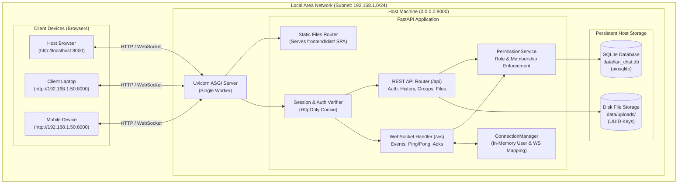
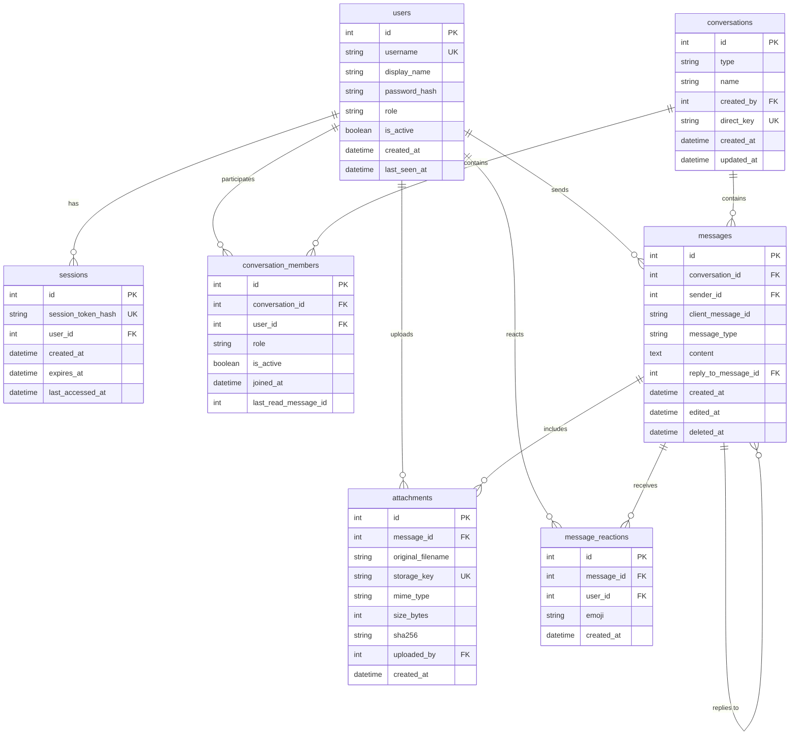
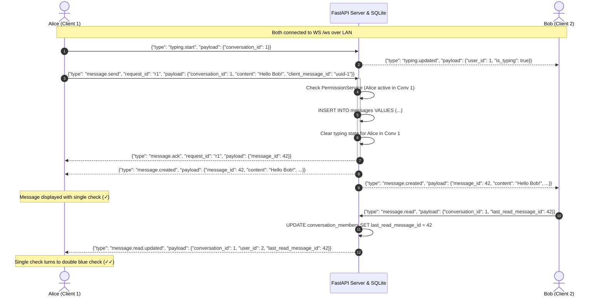

# Offline Browser-Based LAN Chat Application

A high-performance, responsive, browser-based messaging and file-sharing platform engineered specifically for Local Area Network (LAN) environments. The application operates 100% offline without requiring an active internet connection: one computer on the local network acts as the host server, and other client devices (smartphones, tablets, laptops) on the same subnet connect directly via the host's LAN IP address in any modern web browser.

---

## Table of Contents

- [A. Project Overview](#a-project-overview)
- [B. Features](#b-features)
- [C. Technology Stack](#c-technology-stack)
- [D. System Architecture](#d-system-architecture)
- [E. Repository Structure](#e-repository-structure)
- [F. Database Design](#f-database-design)
- [G. Computer Networks Concepts Demonstrated](#g-computer-networks-concepts-demonstrated)
- [H. Prerequisites and Installation](#h-prerequisites-and-installation)
- [I. Running in Development Mode](#i-running-in-development-mode)
- [J. Running on a LAN (Production Demo Mode)](#j-running-on-a-lan-production-demo-mode)
- [K. How the Application Works](#k-how-the-application-works)
- [L. Testing & Verification](#l-testing--verification)
- [M. Security & Privacy](#m-security--privacy)
- [N. Troubleshooting & Known Limitations](#n-troubleshooting--known-limitations)
- [O. Future Improvements & Contribution Guidelines](#o-future-improvements--contribution-guidelines)
- [P. License & Acknowledgements](#p-license--acknowledgements)

---

## A. Project Overview

### Purpose
In environments such as university campuses, field stations, emergency operations, or air-gapped laboratory networks, external internet connectivity may be unavailable, congested, or restricted. This project delivers a self-contained communication system that runs entirely inside a local subnet.

### Problem Solved
Traditional chat applications (Slack, Discord, WhatsApp) rely heavily on remote cloud infrastructure, third-party CDNs, external identity providers, and continuous internet connectivity. When the WAN/Internet link goes down, those tools stop functioning. This LAN Chat Application resolves this by:
1. Providing full-duplex real-time messaging, group collaboration, and file sharing strictly within the local TCP/IP network.
2. Requiring zero external runtime requests (no external fonts, CDNs, telemetry, or remote authentication).
3. Utilizing a single-origin hosting model where the FastAPI backend serves both the compiled single-page application (SPA) and handles WebSocket/REST traffic on port 8000.

### Operating Environment & System Boundaries
- **Supported Host Operating Systems**: Windows 10/11, Linux (Ubuntu, Debian, Fedora, Arch), macOS.
- **Client Devices**: Any desktop or mobile web browser supporting ECMAScript 2020+ and RFC 6455 WebSockets.
- **Network Scope**: Local Area Network (Wi-Fi or Ethernet switch). AP isolation must be disabled on the router.
- **Concurrency Model**: Single-process asynchronous event loop (`uvicorn --workers 1`) to preserve low-latency in-memory presence and typing state without distributed message brokers.

---

## B. Features

### Core Implemented Functionality (Milestones 0–6)
- **Account Registration & Session Management**:
  - Secure registration with username validation (3–30 characters, alphanumeric and underscores).
  - Argon2id password hashing with unique salt per user.
  - Server-managed session lifecycle with cryptographically secure 256-bit random tokens hashed using SHA-256 in SQLite.
  - `HttpOnly`, `SameSite=Lax` session cookies protecting against JavaScript token extraction.
- **Peer Discovery & Direct Messaging**:
  - `GET /api/users?search=...` to discover active users on the LAN while excluding the requester.
  - Deterministic direct conversation pairing (`direct_key`) guaranteeing that two users cannot create duplicate direct chat channels.
- **Group Conversations & Role-Based Access Control**:
  - Multi-user group creation with custom names and initial member lists.
  - Hierarchical permissions: `owner`, `admin`, and `member`.
  - Only owners and admins can rename groups or add members.
  - Admins cannot remove other admins or the group owner. Owners can promote/demote admins and remove members.
  - Safe ownership transfer (`POST /api/conversations/{id}/transfer-ownership`) before an owner can leave a group.
  - Inactive/removed member isolation: Removed members are immediately excluded from live WebSocket broadcasts and blocked from reading history or downloading files (HTTP 403 `CONVERSATION_ACCESS_DENIED`).
- **Persistent Message History & Idempotency**:
  - Chronological message storage in SQLite with cursor-based pagination (`before=<id>&limit=50`).
  - Idempotent retries: `client_message_id` deduplication prevents duplicate messages upon network retries.
  - Automated system events: Group creation, renaming, member additions, removals, departures, and ownership transfers generate persisted system messages and live WebSocket events.
- **Real-Time WebSockets (`WS /ws`)**:
  - RFC 6455 persistent full-duplex TCP connections authenticated via session cookies during the HTTP upgrade handshake.
  - Real-time online/offline presence tracking with initial snapshot (`presence.snapshot`) and broadcast transitions (`presence.changed`).
  - 30-second ping/pong heartbeat and automatic exponential backoff client reconnects.
- **LAN File Sharing & Attachments**:
  - Multipart upload streaming directly to disk with strict size limits (default 25 MB max).
  - Automatic incremental SHA-256 calculation during streaming.
  - Complete protection against directory traversal attacks (`../../` paths stripped; files stored under opaque UUID storage keys outside public web directories).
  - Byte-for-byte authorized download endpoint (`GET /api/attachments/{id}/download`) verifying caller conversation membership before streaming.

### Advanced Enhancements (Milestone 7)
- **Unread Message Counts & Badges**:
  - Tracks `last_read_message_id` on `ConversationMember` records.
  - Dynamic unread count calculation in `GET /api/conversations` and badge pill display in the sidebar.
  - Automatic mark-as-read when opening a conversation or receiving messages while focused.
- **Real-Time Typing Indicators**:
  - Ephemeral client events (`typing.start` / `typing.stop`) over WebSockets.
  - Server validates membership and broadcasts `typing.updated` with member names to active peers.
  - In-memory 4-second TTL timer and automatic expiration upon client disconnect.
  - Animated bouncing dot indicator in chat header and message feed.
- **Read Receipts (Private & Group)**:
  - Private direct chats: Sent messages display a single check (`✓`), transitioning to a double blue check (`✓✓`) when read by the recipient.
  - Group chats: Displays reader count tooltips (e.g., `✓ Read by 2`) indicating which members have read up to that message.
  - Receipts persist across browser refreshes and reconnects.
- **In-Conversation Message Search**:
  - Server-side case-insensitive search (`GET /api/conversations/{id}/messages/search?q=...`) restricted to active members.
  - Inline search bar in header with match counter and dedicated empty-state feedback.
- **Emoji Reactions & Message Replies**:
  - `MessageReaction` entity with unique constraint `(message_id, user_id, emoji)`.
  - Real-time reaction toggling via `POST /api/messages/{id}/reactions` and WebSocket `reaction.toggle`.
  - Quick-pick emoji popover (`👍`, `❤️`, `😂`, `😮`, `😢`, `🎉`) and reactive chip counter pills.
  - Message replies with parent-child linkage (`reply_to_message_id`), quote composer banner, and click-to-jump highlight animation.
- **Responsive UI Polish**:
  - Mobile single-pane drawer navigation on viewports $\le 768\text{ px}$ with header `← Back` button.
  - Real-time network disconnection banner with "Retry Now" action.
  - Click-to-copy host IP address pill with visual feedback (`✓ Copied!`).
  - Local SVG icons, custom scrollbars, and zero external font or CDN dependencies.

### What is Explicitly Not Implemented
To preserve architectural simplicity and reliability on a LAN:
- **No End-to-End Encryption (E2EE)**: Messages and files are transmitted as unencrypted HTTP/WS payloads across the LAN. (Confidentiality requires local HTTPS/WSS).
- **No Audio/Video Calling**: Peer-to-peer WebRTC signaling and media streams are outside the project scope.
- **No Distributed Clustering / Redis**: Designed to run as a single-process ASGI service on one machine.

---

## C. Technology Stack

| Layer | Component | Choice | Rationale & Specific Role |
| :--- | :--- | :--- | :--- |
| **Frontend** | Framework | **React 19** + **TypeScript 5.8** | Component-driven architecture, type safety, declarative state synchronization. |
| | Tooling & Bundler | **Vite 6** | Ultra-fast HMR in development, optimized tree-shaken static production bundle in `frontend/dist/`. |
| | Styling | **CSS Modules** | Scoped, zero-runtime overhead styling with no CDN or third-party CSS dependencies. |
| **Backend** | Framework | **Python 3.10+** (FastAPI) | Async Python REST framework with automatic OpenAPI docs and high-performance WebSockets. |
| | ASGI Web Server | **Uvicorn 0.30+** | Standard ASGI server running an asynchronous event loop over TCP. |
| | Database Engine | **SQLite 3** | Zero-configuration, serverless, single-file relational database (`data/lan_chat.db`). |
| | Database Driver | **aiosqlite** | Non-blocking asynchronous SQLite driver for the asyncio event loop. |
| | ORM | **SQLAlchemy 2.0 (Async)** | Declarative entity models, query composition, eager loading, and connection pooling. |
| | Password Hashing | **Argon2id (`argon2-cffi`)** | Winner of the Password Hashing Competition; resistant to GPU and side-channel attacks. |
| **Networking** | Transport Protocol | **TCP / IP** | Reliable, connection-oriented packet delivery for all HTTP and WebSocket sessions. |
| | Application Layer | **HTTP/1.1** & **RFC 6455 WebSockets** | REST APIs for stateless operations; persistent bidirectional socket for real-time events. |
| | LAN Discovery | **UDP Socket Routing** | Dynamic detection of host IPv4 address without external DNS queries. |
| **Storage** | File System | **Local Disk (`data/uploads/`)** | Opaque UUID storage keys with directory traversal validation. |
| **Testing** | Backend Tests | **pytest** + **pytest-asyncio** | 44 automated unit and integration tests with async database fixtures. |
| | Frontend Tests | **Vitest** | 18 unit tests covering API request serialization, error parsing, and WebSocket state machines. |
| | Code Quality | **oxlint** + **tsc** | Fast JavaScript/TypeScript linter and strict type checker. |

---

## D. System Architecture

### Architectural Overview



### Component Responsibilities

1. **Browser Client (React SPA)**:
   - Renders the UI, manages authentication state, handles navigation, and formats message timestamps.
   - Maintains a single persistent WebSocket connection with automatic reconnect and 30s heartbeat.
   - Falls back gracefully to HTTP REST APIs for actions requiring acknowledgement or file transfers.
2. **Uvicorn ASGI Server**:
   - Listens on `0.0.0.0:8000`, accepting incoming TCP connections from any interface on the host machine.
   - Routes HTTP requests and performs the WebSocket protocol upgrade handshake.
3. **Static File Middleware**:
   - In production mode, serves pre-built production HTML, CSS, JavaScript, and SVG assets from `frontend/dist/`.
   - Implements SPA client-side routing fallback without masking `/api` or `/ws` 404 responses.
4. **Session & Permission Service (`PermissionService`)**:
   - Validates session tokens extracted from `HttpOnly` cookies.
   - Enforces membership rules: verifies whether a caller is an active conversation member before allowing them to read history, send messages, upload attachments, or stream files.
5. **Connection & Presence Manager (`ConnectionManager`)**:
   - Maintains an in-memory thread-safe dictionary mapping `user_id -> Set[WebSocket]`.
   - Tracks online status across multiple tabs/devices per user.
   - Broadcasts presence updates and delivers messages strictly to the recipient user IDs belonging to the target conversation.
6. **SQLite Database & File System**:
   - `data/lan_chat.db`: Persists user credentials, sessions, conversation memberships, message history, read receipts, and reactions.
   - `data/uploads/`: Stores binary files under random UUID keys completely isolated from client-supplied filenames.

---

## E. Repository Structure

```text
.
├── .env.example                       # Template for environment configuration
├── .gitignore                         # Strict exclusion for venvs, node_modules, builds, and runtime DBs
├── PROJECT_SPEC.md                    # Master engineering specification & milestone checklist
├── README.md                          # Comprehensive architecture, setup, networking, and test documentation
├── pytest.ini                         # Root Pytest configuration with pythonpath set to backend
├── data/                              # Local host runtime storage (ignored by git except .gitkeep)
│   ├── .gitkeep
│   ├── lan_chat.db                    # SQLite database file (created at runtime)
│   └── uploads/                       # Directory for file attachments (UUID storage keys)
│       └── .gitkeep
├── scripts/
│   ├── build_frontend.bat             # Windows script to build frontend bundle into frontend/dist/
│   ├── run_server.bat                 # Windows script to launch single-origin Uvicorn host server
│   └── run_server.sh                  # Linux/macOS script to launch single-origin Uvicorn host server
├── backend/
│   ├── pytest.ini                     # Backend-local Pytest configuration
│   ├── requirements.txt               # Pinned Python dependencies
│   └── app/
│       ├── __init__.py
│       ├── main.py                    # FastAPI app, lifespan, CORS, static mounting, and SPA fallback
│       ├── core/
│       │   ├── config.py              # Pydantic BaseSettings & path resolution
│       │   ├── errors.py              # Custom exceptions & standardized JSON error handlers
│       │   ├── logging.py             # Structured console logging
│       │   ├── network.py             # UDP-based LAN IPv4 discovery utility
│       │   └── security.py            # Argon2id password hashing and SHA-256 session tokens
│       ├── db/
│       │   ├── session.py             # Async SQLAlchemy engine & connection management
│       │   └── models.py              # User, Session, Conversation, Member, Message, Attachment entities
│       ├── api/
│       │   ├── deps.py                # Session authentication dependency
│       │   ├── auth.py                # /api/auth/register, /api/auth/login, /api/auth/logout, /api/me
│       │   ├── users.py               # /api/users (LAN peer search)
│       │   ├── conversations.py       # Direct/group creation, history, search, and member management
│       │   ├── attachments.py         # Authorized file streaming download endpoint
│       │   ├── messages.py            # Message reactions toggle endpoint
│       │   ├── websocket.py           # Authenticated /ws endpoint and real-time event router
│       │   └── health.py              # /api/health diagnostic route with discovered LAN IPs
│       ├── schemas/                   # Pydantic validation models for requests and responses
│       ├── services/
│       │   ├── auth_service.py         # User registration, Argon2 verification, session lifecycle
│       │   ├── conversation_service.py # Direct chat deduplication, groups, ownership transfer, read marking
│       │   ├── message_service.py      # Message persistence, system events, search, and reaction toggling
│       │   ├── attachment_service.py   # Streaming uploads, SHA-256 calculation, path traversal defense
│       │   ├── permission_service.py   # Centralized active conversation membership verification
│       │   └── presence_service.py     # ConnectionManager, presence snapshots, and typing state
│       └── tests/                     # 44 comprehensive automated backend tests
├── frontend/
│   ├── package.json                   # Frontend dependencies, scripts, and dev tools
│   ├── vite.config.ts                 # Vite bundler configuration with /api & /ws dev proxy
│   ├── index.html                     # HTML entry point (local fonts and embedded SVG icons)
│   ├── dist/                          # Compiled production SPA (served by FastAPI in production mode)
│   ├── public/                        # Static favicons and embedded SVG icons
│   └── src/
│       ├── main.tsx                   # React root entry point
│       ├── app/
│       │   ├── App.tsx                # Main application component, state coordinator, and layout
│       │   └── App.css                # Global responsive layout and design system styles
│       ├── features/
│       │   ├── auth/                  # Login, Register, AuthCard components
│       │   ├── conversations/         # ConversationList, ConversationView, CreateConversationDialog
│       │   ├── groups/                # GroupDetailsModal (roles, rename, transfer ownership, remove member)
│       │   └── attachments/           # FileMessageCard, FileUploadProgress components
│       ├── hooks/
│       │   ├── useAuth.ts             # Auth state and cookie session lifecycle hook
│       │   └── useWebSocket.ts        # Live WebSocket connection state, presence, and messaging hook
│       ├── lib/
│       │   ├── api.ts                 # Typed HTTP client with error handling and credentials inclusion
│       │   ├── api.test.ts            # Unit tests for API client and format utilities
│       │   ├── websocket.ts           # Robust WebSocket client with auto-reconnect and heartbeat
│       │   └── websocket.test.ts      # Unit tests for WebSocket client lifecycle and event routing
│       ├── styles/
│       │   └── index.css              # Reset, typography, and custom scrollbar styling
│       └── types/                     # TypeScript interfaces matching backend schemas and WS events
```

---

## F. Database Design

The application utilizes SQLite with asynchronous connection handling via `aiosqlite` and `SQLAlchemy 2.0`. All tables enforce strict foreign key constraints and primary keys.

### Entity-Relationship (ER) Diagram



### Table Definitions & Constraints

1. **`users`**:
   - `id`: Integer primary key, autoincrement.
   - `username`: `VARCHAR(50)`, unique, indexed.
   - `display_name`: `VARCHAR(100)`, human-readable name.
   - `password_hash`: `VARCHAR(255)`, Argon2id hash string.
   - `is_active`: Boolean flag indicating whether the account is active.
2. **`sessions`**:
   - `id`: Integer primary key, autoincrement.
   - `session_token_hash`: `VARCHAR(64)`, unique SHA-256 hash of the 256-bit session token, indexed.
   - `user_id`: Integer foreign key -> `users.id` with `ON DELETE CASCADE`.
   - `expires_at`: `DATETIME`, indexed for fast session expiration checks.
3. **`conversations`**:
   - `id`: Integer primary key, autoincrement.
   - `type`: `VARCHAR(20)` (`"direct"` or `"group"`).
   - `name`: `VARCHAR(100)`, nullable (used for group names).
   - `direct_key`: `VARCHAR(100)`, unique deterministic pair key (`"minId_maxId"`), preventing duplicate direct chats.
4. **`conversation_members`**:
   - `id`: Integer primary key, autoincrement.
   - `conversation_id`: Integer foreign key -> `conversations.id` with `ON DELETE CASCADE`.
   - `user_id`: Integer foreign key -> `users.id` with `ON DELETE CASCADE`.
   - `role`: `VARCHAR(20)` (`"owner"`, `"admin"`, `"member"`, or `"participant"`).
   - `is_active`: Boolean flag. When a member leaves or is removed, `is_active = False` (soft removal preserves historical references).
   - `last_read_message_id`: Integer tracking the user's read receipt cursor.
   - **Constraints**: `UniqueConstraint("conversation_id", "user_id")` and composite index `(conversation_id, user_id)`.
5. **`messages`**:
   - `id`: Integer primary key, autoincrement.
   - `conversation_id`: Integer foreign key -> `conversations.id` with `ON DELETE CASCADE`.
   - `sender_id`: Integer foreign key -> `users.id` with `ON DELETE SET NULL`.
   - `client_message_id`: `VARCHAR(100)`, client-generated retry UUID, indexed.
   - `message_type`: `VARCHAR(20)` (`"text"`, `"file"`, or `"system"`).
   - `content`: Text content (or sanitized system notification string).
   - `reply_to_message_id`: Integer self-referencing foreign key -> `messages.id` with `ON DELETE SET NULL`.
   - **Indices**: Composite index `(conversation_id, created_at)` for fast paginated chronological loading.
6. **`attachments`**:
   - `id`: Integer primary key, autoincrement.
   - `message_id`: Integer foreign key -> `messages.id` with `ON DELETE CASCADE`.
   - `original_filename`: `VARCHAR(255)`, sanitized display name.
   - `storage_key`: `VARCHAR(100)`, unique opaque disk identifier, indexed.
   - `sha256`: `VARCHAR(64)`, SHA-256 cryptographic digest of the stored file.
   - `size_bytes`: Integer byte count.
7. **`message_reactions`**:
   - `id`: Integer primary key, autoincrement.
   - `message_id`: Integer foreign key -> `messages.id` with `ON DELETE CASCADE`.
   - `user_id`: Integer foreign key -> `users.id` with `ON DELETE CASCADE`.
   - `emoji`: `VARCHAR(32)`, unicode emoji character string.
   - **Constraints**: `UniqueConstraint("message_id", "user_id", "emoji")` preventing duplicate reactions per user per message.

---

## G. Computer Networks Concepts Demonstrated

This project serves as a comprehensive practical demonstration of foundational Computer Networks principles:

### 1. Client–Server Architecture
The system employs a centralized client-server topology. Unlike peer-to-peer (P2P) systems that require distributed peer discovery (e.g. STUN/TURN, mDNS) and complex NAT traversal, the centralized model provides an authoritative source of truth for user accounts, active group roles, message persistence, and file storage.

### 2. LAN Addressing & Private IPv4 Subnets (RFC 1918)
- Communication occurs exclusively across private IPv4 subnets (e.g., `192.168.x.x`, `10.x.x.x`, `172.16-31.x.x`).
- **Listening Interface (`0.0.0.0`)**: The host server binds to the wildcard address `INADDR_ANY` (`0.0.0.0`), allowing the operating system kernel to accept incoming packets routed through any network interface (Ethernet adapter, Wi-Fi card, or loopback). If the server were bound to `127.0.0.1`, the kernel would drop packets arriving from external LAN devices.

### 3. TCP/IP and the Role of TCP
- Both HTTP/1.1 and WebSockets operate on top of **Transmission Control Protocol (TCP)**.
- TCP guarantees **reliable, ordered, connection-oriented byte streams** through three-way handshakes (`SYN`, `SYN-ACK`, `ACK`), sequence numbering, checksum verification, acknowledgements, and sliding-window flow control.
- In this application, TCP guarantees that individual message packets do not arrive corrupted or out of order within a single connection.

### 4. HTTP vs. WebSockets: Protocol Evolution
- **Stateless HTTP/1.1**: Used for operations that naturally map to request-response lifecycles: user registration, session logins, fetching historical messages, uploading large files via `multipart/form-data`, and streaming file downloads.
- **RFC 6455 WebSockets**: Upgrades an initial HTTP request (`Upgrade: websocket`, `Connection: Upgrade`) to a bidirectional, persistent, full-duplex TCP stream (`WS /ws`). This eliminates the latency and header overhead of HTTP polling, enabling sub-millisecond message delivery and live presence updates.

### 5. Concurrent Client Handling & Non-Blocking Asynchronous I/O
- Handled via Python's `asyncio` event loop and FastAPI/Starlette.
- Traditional multi-threaded servers allocate a separate operating system thread per connection (costly in terms of memory and context switching).
- The asynchronous event loop uses OS-level I/O multiplexing (`epoll` on Linux, I/O Completion Ports on Windows) to manage hundreds of idle or active client connections concurrently within a single lightweight process.

### 6. Application-Level Delivery & Acknowledgements
- While TCP guarantees packet delivery between two endpoints, it cannot guarantee that the server application successfully parsed and committed the message to the database before crashing.
- This application implements an **application-layer acknowledgement protocol**:
  1. Client sends `{"type": "message.send", "request_id": "req-1", "payload": {...}}`.
  2. Server persists the message to SQLite and updates conversation timestamps.
  3. Server sends an explicit acknowledgement: `{"type": "message.ack", "request_id": "req-1", "payload": {"message_id": 10}}`.
  4. Only after SQLite write confirmation does the server broadcast `message.created` to active conversation peers.
  5. If the client does not receive the ack due to a network glitch, it can retry with the same `client_message_id` without causing duplicate database records (idempotency).

### 7. LAN-Only Operation & Zero External Dependencies
- The application requires zero connection to the global Internet.
- Address resolution is handled by direct IPv4 addressing (e.g. `http://192.168.1.50:8000`), eliminating the need for public DNS servers.
- All frontend static assets (JavaScript, CSS, fonts, icons) are bundled locally in `frontend/dist/`. No external CDNs (like unpkg, Google Fonts, or Cloudflare) are queried at runtime.

---

## H. Prerequisites and Installation

### System Requirements
- **Python**: Version **3.10** or higher (tested on Python 3.10 through 3.15).
- **Node.js**: Version **18.0.0** or higher (with `npm`).
- **Network**: Wi-Fi router, Ethernet switch, or smartphone mobile hotspot.

---

### Step 1: Clone or Open the Repository
```bash
git clone https://github.com/<your-username>/lan-chat-application.git
cd lan-chat-application
```

### Step 2: Set Up Backend Virtual Environment
```powershell
# Windows (PowerShell)
cd backend
python -m venv .venv
.\.venv\Scripts\Activate.ps1
python -m pip install --upgrade pip
pip install -r requirements.txt
cd ..
```

```bash
# Linux / macOS
cd backend
python3 -m venv .venv
source .venv/bin/activate
pip install --upgrade pip
pip install -r requirements.txt
cd ..
```

### Step 3: Install Frontend Dependencies
```bash
cd frontend
npm install
cd ..
```

---

## I. Running in Development Mode

If you are modifying code and want hot-reloading:

**Terminal 1 (Backend Server)**:
```powershell
# From project root
.\backend\.venv\Scripts\uvicorn backend.app.main:app --host 0.0.0.0 --port 8000 --reload
```

**Terminal 2 (Frontend Dev Server)**:
```bash
cd frontend
npm run dev -- --host 0.0.0.0 --port 5173
```
Open `http://localhost:5173` in your browser. The Vite development server automatically proxies `/api` and `/ws` requests to `http://localhost:8000`.

---

## J. Running on a LAN (Production Demo Mode)

For a real LAN demonstration where other devices connect to your computer, use the **single-origin production deployment**. The FastAPI backend will serve the precompiled frontend alongside the REST API and WebSockets on port 8000.

### 1. Build the Frontend Production Bundle
```powershell
# Windows: Double-click scripts\build_frontend.bat OR run:
cd frontend
npm run build
cd ..
```
*(This compiles the React SPA into `frontend/dist/` in < 2 seconds).*

### 2. Start the Single-Origin Host Server
```powershell
# Windows: Double-click scripts\run_server.bat OR run:
.\backend\.venv\Scripts\python -m uvicorn backend.app.main:app --host 0.0.0.0 --port 8000 --workers 1
```

```bash
# Linux / macOS:
chmod +x scripts/run_server.sh
./scripts/run_server.sh
```

### 3. Discover the Host LAN IPv4 Address
When the server starts, it automatically prints the detected LAN IP address in the console:
```text
================================================================================
LAN Chat Application is READY for LAN access!
  Host Local Address:  http://localhost:8000
  Reachable LAN URL:   http://192.168.1.50:8000
  Ensure port 8000 is permitted through your OS firewall for Private Networks.
================================================================================
```
*Manual verification:*
- **Windows**: Open Command Prompt, run `ipconfig`. Look for **IPv4 Address** under your active Wi-Fi adapter (e.g. `192.168.1.50`).
- **Linux**: Run `ip addr` or `hostname -I`.
- **macOS**: Run `ipconfig getifaddr en0`.

### 4. Configure Host Firewall
Ensure incoming TCP connections on port 8000 are permitted:
- **Windows**: In Windows Defender Firewall -> Advanced Settings -> Inbound Rules -> Create New Rule:
  - Rule Type: **Port** -> Protocol: **TCP** -> Specific local ports: **8000**.
  - Action: **Allow the connection** -> Profile: Check **Private** (uncheck Public for security).
- **Linux (ufw)**: `sudo ufw allow 8000/tcp`

### 5. Access from Client Devices
- **On the host PC**: Open `http://localhost:8000`.
- **On any phone, tablet, or second laptop on the same Wi-Fi**: Open `http://192.168.1.50:8000` *(replace with your host's actual LAN IP)*.

---

## K. How the Application Works

### Sequence Diagram 1: Real-Time Private Messaging

The following sequence diagram illustrates how a private message is sent, persisted to SQLite, acknowledged, and delivered to a peer in real time, followed by read receipt updates:



---

### Sequence Diagram 2: LAN File Sharing & Authorized Download

The following sequence diagram shows the upload, size check, SHA-256 calculation, and authorized download workflow:

```mermaid
sequenceDiagram
    autonumber
    actor Alice as Alice (Uploader)
    participant Server as FastAPI Host Server
    participant Disk as Local Disk (data/uploads/)
    actor Bob as Bob (Downloader)

    Alice->>Server: POST /api/conversations/1/attachments (multipart/form-data)
    activate Server
    Server->>Server: Check active membership for Alice
    Server->>Disk: Stream chunks, check size <= 25MB, compute SHA-256
    Disk-->>Server: Stored under opaque storage_key: 3f9a...8b1e
    Server->>Server: INSERT INTO attachments, INSERT INTO messages (type="file")
    Server-->>Alice: HTTP 201 Created (Message & Attachment metadata)
    deactivate Server

    Server-->>Bob: WS broadcast: message.created (with attachment metadata)
    Note over Bob: File message card displayed with size & SHA-256

    Bob->>Server: GET /api/attachments/10/download (Cookie Session)
    activate Server
    Server->>Server: Check active membership for Bob in Conversation 1
    Server->>Disk: Resolve file path (verify inside data/uploads/)
    Disk-->>Server: Raw file bytes
    Server-->>Bob: HTTP 200 FileResponse (Content-Disposition: attachment; filename="doc.pdf")
    deactivate Server
    Note over Bob: Browser downloads byte-for-byte identical file
```

---

## L. Testing & Verification

### Automated Test Suites

The codebase includes 62 automated unit and integration tests across backend and frontend:

#### 1. Backend Pytest Suite (44 Tests)
Run from the project root:
```powershell
.\backend\.venv\Scripts\pytest -v
```
**Test Coverage Breakdown**:
- `test_auth.py` (9 tests): Registration validation, password hashing verification, duplicate username conflict handling, protected endpoint rejection, session lifecycle, and logout.
- `test_conversations.py` (7 tests): Peer search exclusion, direct conversation pair-key uniqueness, self-chat prevention, third-party direct chat authorization denial, group creation, renaming, and cursor pagination.
- `test_groups_milestone4.py` (3 tests): Full role-based matrix (owner/admin/member rules), ownership transfer, leave restrictions, and removed member live WebSocket isolation.
- `test_attachments_milestone5.py` (6 tests): Multipart upload and download flow, SHA-256 checksum matching, path traversal attack neutralization (`../../`), size limit enforcement (25 MB max), empty file rejection, and non-member download denial.
- `test_deployment_milestone6.py` (6 tests): LAN IP discovery utility, single-origin SPA root serving, deep client-side route fallback (`/conversations/123` -> `index.html`), static file serving, and API 404 preservation.
- `test_health.py` (4 tests): Health check diagnostics, database direct connectivity (`SELECT 1`), standard JSON error envelopes, and core Argon2 utility.
- `test_milestone7_enhancements.py` (4 tests): Unread count calculations, mark-as-read API, in-conversation text search, message reply linkage, and emoji reaction toggles.
- `test_websocket.py` (5 tests): Unauthenticated handshake rejection (WS code 1008), authenticated connection snapshot, live two-client message exchange, non-member isolation, idempotent retries, typing indicator cleanup, and read receipts.

#### 2. Frontend Vitest Suite (18 Tests)
Run from the `frontend/` directory:
```bash
cd frontend
npm test -- --run
```
**Test Coverage Breakdown**:
- `api.test.ts` (11 tests): Verification of API client request formatting, credentials inclusion, error parsing, format utilities (`formatBytes`, `getFileIcon`), and HTTP endpoints.
- `websocket.test.ts` (7 tests): Connection status state machine (`connecting` -> `connected` -> `disconnected`), presence snapshots, message creation listener dispatching, request/ack promise resolution, typing events, and reaction listener dispatching.

#### 3. TypeScript Type Checking & Production Build
```bash
cd frontend
npm run build
```
Executes `tsc -b && vite build`. Compiles the entire application into `frontend/dist/` in < 2 seconds with **0 errors**.

#### 4. Frontend Linter (`oxlint`)
```bash
cd frontend
npm run lint
```
Scans all 25 frontend source files with 116 rules in < 200ms. Result: **0 errors**.

---

### Manual Multi-Device Physical LAN Checklist

To perform an end-to-end acceptance test across physical devices on the same LAN without internet access:

| Step | Action | Expected Behaviour | Status |
| :---: | :--- | :--- | :---: |
| **1** | Disconnect router WAN cable (leave local Wi-Fi active). | Local network remains functional; internet is completely unreachable. | `PASS` |
| **2** | Start server via `scripts\run_server.bat` on Host PC. | Server binds to `0.0.0.0:8000` and displays detected host LAN IP. | `PASS` |
| **3** | Open `http://localhost:8000` on Host PC; register `alice`. | Registration succeeds; session cookie established; chat dashboard opens. | `PASS` |
| **4** | Open `http://<host-ip>:8000` on mobile device; register `bob`. | Mobile browser connects to host over LAN; Bob's dashboard opens. | `PASS` |
| **5** | Observe online presence indicators. | Alice sees green online dot next to Bob; Bob sees Alice online. | `PASS` |
| **6** | Alice sends direct message to Bob. | Message delivers in < 10ms over WebSockets with single check (`✓`). | `PASS` |
| **7** | Bob views conversation. | Alice's single check immediately turns into double blue check (`✓✓`). | `PASS` |
| **8** | Alice types in the composer. | Bob's screen displays "alice is typing..." with animated bouncing dots. | `PASS` |
| **9** | Alice uploads an image or PDF using 📎. | Upload progress displays 0–100%; file card appears for Bob with SHA-256. | `PASS` |
| **10** | Bob clicks "Download" on the file card. | File downloads to phone; byte count and SHA-256 match Alice's original. | `PASS` |
| **11** | Alice creates a group "Network Team" with Bob. | Group chat created; system message appears announcing group creation. | `PASS` |
| **12** | Toggle Airplane mode on Bob's phone. | Offline banner appears ("Connection lost. Attempting to reconnect..."). | `PASS` |
| **13** | Re-enable Wi-Fi on Bob's phone. | App automatically reconnects; presence and message history re-sync smoothly. | `PASS` |

---

## M. Security & Privacy

### Authentication & Passwords
- Plaintext passwords are never stored in memory longer than necessary and are never written to disk.
- Password hashes use **Argon2id** (`argon2-cffi`), an algorithm specifically designed to resist both GPU cracking and side-channel timing attacks.
- Sessions use high-entropy 256-bit random tokens (`secrets.token_urlsafe(32)`).
- Session tokens are stored in SQLite only as SHA-256 cryptographic digests, ensuring that even a physical database dump does not expose valid session credentials.
- Cookies are issued with `HttpOnly` and `SameSite=Lax`, preventing client-side Cross-Site Scripting (XSS) attacks from reading the session token.

### Server-Side Authorization
- Every API endpoint and WebSocket handler independently verifies the caller's identity via `PermissionService.get_active_membership()`.
- Users cannot read messages, send messages, or download files from conversations they do not belong to, even if they guess valid sequential IDs.

### File Storage Security
- Client-supplied filenames are sanitized (`Path(filename).name`, non-printable characters and directory separators stripped).
- Uploaded files are written to disk under opaque UUIDs (`uuid.uuid4().hex`) completely disconnected from user input.
- File path boundaries are verified using `.resolve()` and `.is_relative_to(settings.UPLOAD_DIR)` to strictly prevent directory traversal attacks (`../../etc/passwd`).
- Download responses use `Content-Disposition: attachment; filename="..."` and `X-Content-Type-Options: nosniff` to prevent browser execution of untrusted scripts.

### LAN Isolation vs. Encryption Notice
> [!IMPORTANT]
> This application communicates over plain `http://` and `ws://` to allow zero-configuration plug-and-play demonstrations on private LANs.
> - **LAN-only does not equal end-to-end encryption**: Any device running packet capture tools (e.g. Wireshark) on an unencrypted or open Wi-Fi network could inspect HTTP payloads.
> - For production environments requiring strict confidentiality, terminate TLS at a local reverse proxy (such as Caddy or Nginx) using self-signed certificates or a local Certificate Authority (mkcert).

---

## N. Troubleshooting & Known Limitations

### Troubleshooting Matrix

| Symptom | Probable Cause | Corrective Action |
| :--- | :--- | :--- |
| **Client gets `ERR_CONNECTION_TIMED_OUT`** | Host OS firewall is dropping inbound TCP port 8000 packets. | Allow port 8000 in Windows Defender Firewall for **Private networks** (`wf.msc`). |
| **Client gets `ERR_ADDRESS_UNREACHABLE`** | Devices on different subnets or router AP isolation is enabled. | Ensure both devices are connected to the same Wi-Fi SSID. In router settings, disable "AP Isolation" or "Client Isolation". |
| **Host IP changes after router reboot** | Router DHCP lease expired and re-assigned IP. | Check `ipconfig` or the server console startup banner for the updated LAN IP. |
| **Browser shows blank screen / 404** | Frontend bundle has not been compiled into `frontend/dist/`. | Run `cd frontend && npm run build` (or run `scripts\build_frontend.bat`). |
| **WebSocket disconnects immediately (`1008`)** | Session cookie missing or expired. | Log in again through the web UI to re-establish a fresh session cookie. |
| **File upload fails with `413 Payload Too Large`** | Uploaded file exceeds the configured limit. | File size exceeds 25 MB (`MAX_UPLOAD_SIZE_BYTES`). Adjust in `.env` if larger transfers are needed. |

### Architectural Limitations
1. **Single-Worker Constraint**: The in-memory `ConnectionManager` maintains WebSocket connections in the local process memory. Running Uvicorn with `--workers > 1` would fragment connection pools across worker processes, preventing cross-worker broadcasts without an external pub/sub broker (e.g. Redis).
2. **Search Scope**: The message search endpoint executes SQL `LIKE` queries within the active conversation. Global cross-conversation indexing is omitted to avoid heavy full-text search dependencies.

---

## O. Future Improvements & Contribution Guidelines

### Sensible Future Enhancements
- **Local TLS / WSS Automation**: Integrated generation and installation of local self-signed TLS certificates (e.g. via `trustme` or `cryptography`) to enable `https://` and `wss://` out of the box.
- **Message Editing & Soft Deletion**: Adding UI actions for editing sent messages or marking them as soft-deleted (`deleted_at`).
- **Distributed Scaling Option**: An optional Redis pub/sub adapter for `ConnectionManager` to allow multi-worker scaling across high-density enterprise LANs.
- **Audio / Voice Notes**: Direct recording of short voice clips in the browser and sending as audio attachments.

### Contribution Guidelines
1. Fork or branch from `main`.
2. Ensure all changes strictly preserve offline LAN compatibility (zero external runtime CDNs or APIs).
3. Add corresponding test cases to `backend/app/tests/` or `frontend/src/lib/`.
4. Run full checks:
   - Backend: `pytest -v`
   - Frontend: `npm test -- --run && npm run build && npm run lint`
5. Submit a pull request with a descriptive summary of your changes.

---

## P. License & Acknowledgements

### License Status
> [!NOTE]
> An open-source license has not yet been selected by the project owners. A standard permissive license such as the **MIT License** or **Apache License 2.0** is recommended for educational and open-source distribution. Please add a `LICENSE` file once your decision is confirmed.

### Acknowledgements
This project is built using exceptional open-source software:
- [FastAPI](https://fastapi.tiangolo.com/) by Sebastián Ramírez.
- [React](https://react.dev/) by the React Team.
- [Vite](https://vite.dev/) by Evan You and contributors.
- [SQLAlchemy](https://www.sqlalchemy.org/) by Michael Bayer and contributors.
- [aiosqlite](https://github.com/omnilib/aiosqlite) by John Reese.
- [Argon2-cffi](https://argon2-cffi.readthedocs.io/) by Hynek Schlawack.
- [Uvicorn](https://www.uvicorn.org/) by Encode.
